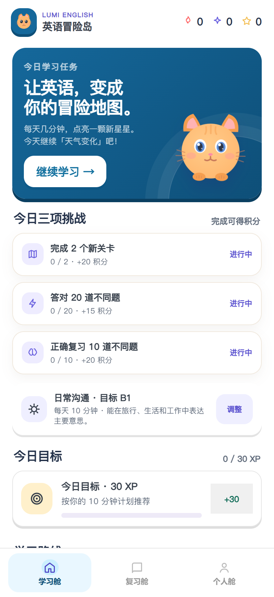
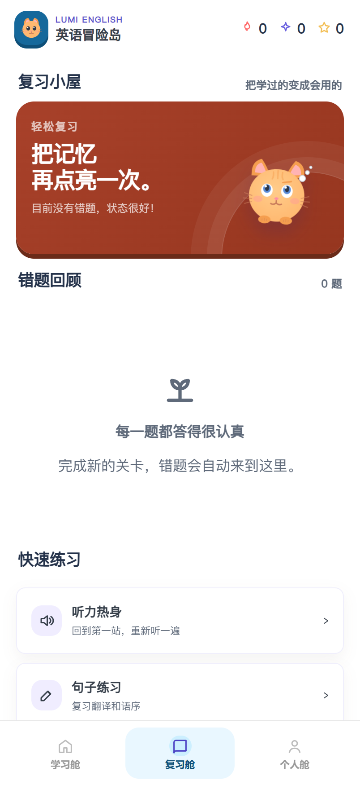
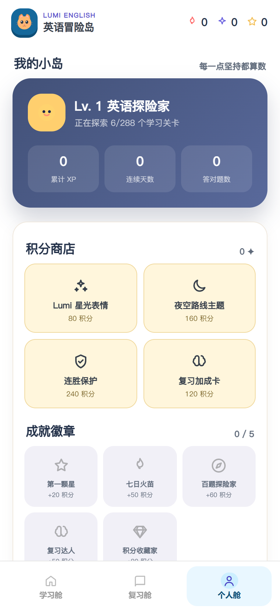

# Lumi English

[](LICENSE)
[](https://github.com/OHHHHHHHJ672/lumi-english/releases)
[](https://github.com/OHHHHHHHJ672/lumi-english/releases)
[](docs/USAGE.md)

一个原创的、完全离线的英语学习游戏 Android 应用，面向中文母语的学习者。用路线图、关卡、XP、积分、连胜和奖励动效，把英语练习拆成每天可以完成的一小段冒险。

> An original, fully offline English-learning game for Android, aimed at
> Chinese-speaking learners. No account, no cloud, no analytics — everything
> runs on your device and nothing is uploaded.

---

## 下载

从 **[Releases](https://github.com/OHHHHHHHJ672/lumi-english/releases)** 下载最新 APK，传到手机上安装即可。

首次安装需要在系统设置里允许「安装未知应用」。APK 由本地密钥签名，升级时请使用同一个 Release 的覆盖安装，跨作者签名不同的包无法直接覆盖。

## 这是什么

| | |
|---|---|
| **课程** | 4 个 CEFR 阶段（A1 / A2 / B1 / B2），各 72 关，共 **288 关** |
| **题量** | 每关 12 题，共 **3,456 道练习**（核心题库 2,880 道 + 每关 2 道对白题） |
| **题型** | 单词释义、中文翻译、听力选择、拼句、填空、词语配对、情景对白 |
| **复习** | 间隔复习（SRS）记录每题掌握度、答题次数、遗忘次数和下次复习时间 |
| **激励** | 每日 XP 目标、连续天数、连击、成就徽章、积分商店 |
| **隐私** | 不需要账号、不接云端、不上传任何学习记录 |

完整功能说明见 **[docs/USAGE.md](docs/USAGE.md)**。

## 界面预览

| 学习舱 | 复习舱 | 个人舱 |
|:---:|:---:|:---:|
|  |  |  |

界面配色遵循 WCAG AA 正文对比度（≥ 4.5:1），深色 hero 与浅色内容区交替，路线图上的完成、当前与锁定状态各自保持独立配色。

## 安装与首次启动

1. 从 Releases 下载 APK 并在手机上安装。
2. 首次启动是六步引导：学习目的 → 英语背景 → 目标等级 → 每日节奏 → 提醒时间 → 等级测试。想快点可以直接点「稍后再测，直接开始」，会按你的英语背景推荐起始难度。
3. 引导结束后进入「学习舱」，从第一个关卡开始。

### 没有朗读声音？

朗读由 **Android 系统 TTS** 提供，本应用不内置语音包。请到「我的 → 检查英语语音」或系统「文字转语音（TTS）设置」里，选择一个 TTS 引擎并安装英语语音数据。部分手机的英语语音包需要联网下载。

### 桌面小组件

长按手机桌面 → 小组件 → Lumi English → 拖到桌面。完成一关后会自动同步今日进度。

## 玩法要点

- 题目开始时**只显示作答指令**，不给完整翻译。句子里的英文单词可以单独点开看释义，完整翻译要提交答案后才出现。
- **答错的题会回到当前关卡队列**，必须做完一轮才算通关；重复练习不会重复发放题目 XP。
- 听力题进入后自动播放一次，可以重播，也可以切慢速。
- 积分可以花 3 点隐藏一个错误选项，也可以在商店里换提示、外观、**连胜保护**和复习加成。积分不限制学习次数。
- 复习小屋会优先推送到期的旧题和你的错题。

## 已知限制

这是 Beta，**还有不少问题**，欢迎提 Issue：

- **内容质量参差**：部分题目由生成器产出，措辞和干扰项的自然度不如人工编写的题目。改进建议和 PR 都欢迎。
- **进度只存在本机**：没有账号也没有云同步，清除应用数据或换手机会丢失进度。
- **TTS 依赖系统**：朗读效果取决于手机上安装的引擎和语音包，不同设备差异较大。
- **同步/提醒依赖本地**：每日提醒和小组件都是本机实现，受系统后台限制影响。

## 从源码构建

用 Android Studio 直接打开本目录即可，这是一个标准 Gradle 工程。

没有 Android Studio 时可以用 PowerShell 脚本：

```powershell
.\build-apk.ps1
```

脚本需要 Android SDK（API 35）和 Java 17，通过 `ANDROID_SDK_ROOT` 和 `JAVA_HOME` 指向对应安装目录，或直接传参数。构建产物在 `build/Lumi-English-1.4.apk`，会用 `signing/` 下的本地密钥签名。

> `signing/` 和 `build/` 已在 `.gitignore` 中，签名密钥**不会**进入仓库。首次构建时脚本会自动生成一套新的本地密钥。

## 校验与测试

```bash
# 运行测试
node --test tests/*.test.js

# 校验核心题库（2,880 道）：CEFR 分层、题型覆盖、中英文混排、题目去重
node tools/validate-course.js

# 校验人工编写课程块的结构与答案一致性
node tools/validate-authored-blocks.js
```

三者都是提交前的门禁，当前全部通过。

## 源码结构

```
app/src/main/assets/
  course.js            课程构建器、题型生成器、核心 144 关
  course-pack-2.js     按 CEFR 分层的主题课程包（第 37–72 关）
  authored-course.js   人工编写的课程块
  model.js             本地进度、SRS 掌握度、每日任务、成就、商店
  practice.js          输出训练题抽取、英文输入规范化、拼写反馈
  app.js               路线图、关卡列表和基础界面
  interaction.js       交互、复习、输出训练、词典、动效、启动规划
app/src/main/java/
  MainActivity.java        WebView 容器、系统 TTS、提醒桥接
  LumiWidgetProvider.java  桌面小组件
tools/                 内容审计、修复脚本和提交前校验器
docs/                  使用说明与设计文档
tests/                 Node 测试
```

界面是 HTML/CSS/JS，跑在 WebView 里；模型层（进度、SRS、成就）是纯 JS，可以在 Node 里直接测试，不依赖 Android 环境。

## 参与贡献

提 Issue 报告 bug 或内容问题都可以，附上**关卡编号和题目**会更容易定位。改代码请先跑一遍上面三个校验命令。

课程内容的改动请保持现有结构：每关 12 题、六种基础题型各至少一题、题目需要带 `grammarTags` 和 `skillTags`。

## 许可

[Apache-2.0](LICENSE)

本项目的内容、角色和视觉均为独立设计，未使用任何第三方学习软件的商标、素材或题库。朗读由系统 TTS 运行时生成，不随应用分发任何语音文件。详见 [NOTICE](NOTICE)。
